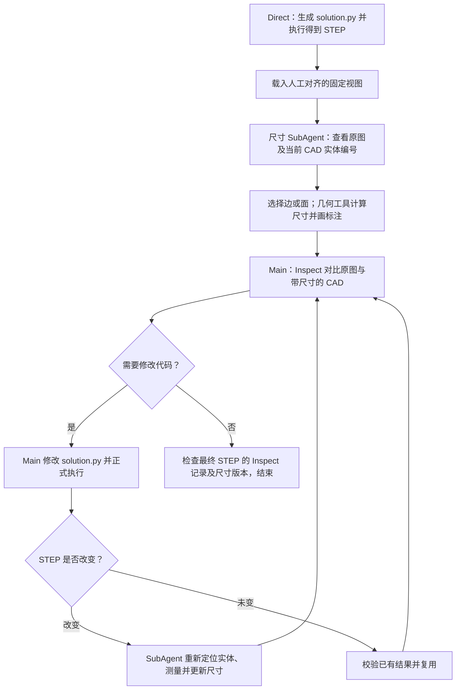

# Main Inspect 中的尺寸标注 SubAgent

在已有“先生成，再由 Main 反思”的流程中，加入一个只负责测量和维护尺寸标注的 SubAgent。它使用人工对齐的相机与投影坐标；Main 仍负责判断模型是否有误、修改 CAD 程序和检查修改结果。

## 找到的原实验

最符合本次描述的是 **`gpt56-optional-reflect-main-preview-4case-20260909-v1`**，内部流程名为 `main_self_reflect_inspect`，包含 102、103、145、146。

| 项目 | 位置 / 设置 |
| --- | --- |
| 原实验合约 | [experiment_contract.json](../results/pi/gpt56-optional-reflect-main-preview-4case-20260909-v1/experiment_contract.json) |
| 原实验计划 | [PLAN.md](../artifacts/experiment/gpt56-optional-reflect-main-preview-4case-20260909-v1/PLAN.md) |
| Direct 初始生成 | `results/pi/gpt56-four-arm-5case-20260821-v1/00-main-agent/<case>` |
| 人工对齐视图 | `artifacts/experiment/gpt56-optional-reflect-main-preview-4case-20260909-v1/calibrated-view-search/<case>` |
| 原反思辅助功能 | `aligned-shape-feedback-v1`，Main 可查看候选修改的形状反馈 |
| 新尺寸配置 | `aligned-dimension-subagent-v1` |

另有一个较早的 `gpt56-self-reflect-plus-inspect-4case-20260822-v1`，但它使用之前自动搜索的视图，不是这里沿用的人工校准版本。上述历史实验没有被改写；新配置默认关闭，只有显式传入参数才启用。

## 实际流程



首次进入 Main 反思前准备尺寸。之后，每次 `execute_build123d` **成功生成有效且封闭的 STEP**，控制器检查尺寸是否需要刷新。Main 调用 `inspect_comparison` 时，会拿到原有的对齐比较图，以及该视图的尺寸比较图和测量结果。

“每次修改”以一次成功的正式执行为界。单独编辑代码、尚未执行，或者执行失败时，不会在旧模型上生成新尺寸。代码变化但 STEP 文件哈希未变时，检查现有图像后复用；STEP 哈希变化时重新测量。完全相同的几何若导出为不同 STEP 文件，也会保守地触发更新。

## SubAgent 怎么选对象、怎么更新

SubAgent 使用与 Main 相同的模型配置，但有独立上下文和三个受限工具：

| 工具 | 用法 | 返回结果 |
| --- | --- | --- |
| `inspect_dimension_entities` | 查看圆边、直边或面；按类型筛选、翻页或查询当前编号 | 带实体编号的当前 CAD 图、三维位置和几何属性 |
| `measure_dimensions` | 指定测量类型、当前实体 ID 和标注位置 | 从 STEP 计算的实际数值、所选实体高亮图、尺寸比较图 |
| `submit_dimension_annotations` | 提交本视图的完整尺寸集合，或说明无法可靠测量的原因 | 可追踪的标注状态 |

它不能修改代码、调整相机或执行任意命令。数值由 CAD 几何工具计算；请求中不能传入图纸上的目标数值作为测量值。选择示例：

```json
{
  "measurements": [
    {
      "dimension_id": "lower_pair_spacing",
      "description": "正视图下方两个安装圆的圆心距",
      "quantity": "center_distance",
      "entity_ids": ["E018", "E017"],
      "offset_px": 48
    }
  ]
}
```

这里的 `E018`、`E017` 只是 case 146 某个 STEP 版本的示例，不能复制到修改后的模型。`dimension_id` 表达“继续检查哪一项尺寸”，可以跨版本保留；实体编号与数值必须来自当前 STEP。

修改后，SubAgent 会收到上一版尺寸的描述，逐项决定：

1. **继续检查**：重新定位当前实体，保留语义 ID 并重新测量。
2. **不再适用或找不到可靠对应**：说明删除原因，不能悄悄丢掉原来的检查项。
3. **需要新增**：选择当前实体并添加新的尺寸项。

每次成功测量最多 12 项，最后一次成功测量是本视图提交的完整集合。SubAgent 可以通过再次测量调整选择或标注位置；提交前应检查工具返回的高亮图和标注图。

## 如何启动新实验

新实验入口是 [run.sh](../artifacts/experiment/gpt56-main-inspect-dimensions-4case-20260930-v1/run.sh)，默认实验编号为 **`gpt56-main-inspect-dimensions-4case-20260930-v1`**。它复用原 Direct 初始模型和人工对齐视图，并保留原来的 Shape Feedback 功能，另加尺寸 SubAgent。

先在仓库根目录编译并构建包含新代码的镜像：

```bash
npm --prefix integrations/pi run build

docker build \
  --file integrations/pi/docker/Dockerfile \
  --tag cadgenbench-pi-agent:0.5.0-main-inspect-dimensions-v1 .
```

然后启动单个 case，或省略 case 参数运行四个 case：

```bash
# 会实际调用模型；本次实现验证没有运行这条命令。
bash artifacts/experiment/gpt56-main-inspect-dimensions-4case-20260930-v1/run.sh 146
```

输出目录必须不存在或为空。再次启动独立实验时，可通过 `CAD_DIMENSION_OUTPUT` 指定新的输出根目录；`CAD_DIMENSION_IMAGE` 可指定另一个已构建的镜像标签。模型认证沿用已有 Pi 实验环境。

已有调用命令只需增加：

```text
--dimension-annotation-profile aligned-dimension-subagent-v1
```

同时必须提供 `--inspect-view-search-root`，其 manifest 必须具有 `projection_frame.policy = fixed`。尺寸配置可以搭配 Inspect 单独使用，也可以与 `aligned-shape-feedback-v1` 组合。它暂不与其他 repair、finding、ablation 配置组合，CLI 会明确报错。

## 本地实测：case 146

[验证脚本](../tools/dimension_subagent_smoke.mjs) 使用真实 case 146、真实 Python worker、精确 STEP 测量和真实固定视图渲染；只有 SubAgent 的选择由脚本给出，**模型调用数为 0**。选择规则根据当前几何重新查找实体，没有直接沿用旧版本 ID。它验证工程闭环，不证明 VLM 能自动正确选择这些对象。

第一次检查使用人工对齐的正视图。随后将独立副本中的 CAD 等比放大 1.1 倍，正式执行新代码，并在不改变相机、像素尺度和投影原点的情况下刷新尺寸。

| 测量项 | 原 CAD | 修改后 CAD |
| --- | ---: | ---: |
| 下方圆心距 | 110 mm | 121 mm |
| 上方圆心距 | 180 mm | 198 mm |
| 前侧圆弧半径 | 30 mm | 33 mm |

原 CAD 的尺寸比较图：


修改后的尺寸比较图：


复现（需要先完成 TypeScript 编译；指定一个全新的输出目录）：

```bash
CADGENBENCH_PYTHON=/data/llh_conda_envs/cadgenbench/bin/python \
LD_LIBRARY_PATH=/data/llh_conda_envs/cadgenbench/lib \
node tools/dimension_subagent_smoke.mjs results/dimension-subagent-case146-repeat
```

本地执行时，worker 附带的等轴渲染因 `/tmp/cadgenbench_render.lock` 权限失败；STEP 有效性检查、固定二维渲染与本文尺寸比较图均成功，报告保留了该错误。

记录保存在 [smoke-report.json](../results/dimension-subagent-case146-20260930/smoke-report.json)。验证还包括：同一 STEP 再次检查不会重复启动子代理、改模后创建新的尺寸版本，以及旧测量会话在传入新 STEP 哈希时被拒绝。

## 结果保存与失败处理

每个 case 的尺寸证据保存在：

```text
drawing_feedback/dimension-annotations/<continuation-hash>/
  state.json                 # 当前状态，包含 source / STEP / manifest 哈希
  last-completed.json        # 上次完整检查，供下一次重新定位时参考
  revision-<uuid>/
    <region-id>/
      current-fixed-frame/   # 冻结投影中的当前 CAD
      catalog-*/             # STEP 快照、实体属性与编号图
      measurement-*/         # 实际数值、高亮图与尺寸比较图
      result.json            # 本视图保留、新增和删除的尺寸
```

子代理会话和用量沿用已有 `runRestrictedSession` 的记录机制，角色为 `dimension_annotation`。新实验合约会记录尺寸配置、刷新策略和相应验收要求。

| 状态 | 含义 |
| --- | --- |
| `annotated` | 当前视图已生成实际尺寸 |
| `not_needed` | 没有适合可靠标注的尺寸，必须解释原因 |
| `unresolved` | 无法可靠建立图纸与当前实体的对应关系，必须解释原因 |
| `unsupported` | 暂不支持该视图的几何测量，例如剖视图 |
| 全局 `failed` | 子代理未提交、worker 失败或正式 CAD 在检查期间发生变化，需要重试 |

`completed` 表示所有选定视图的尺寸检查流程结束，**不表示 CAD 正确，也不要求每个视图都成功标注**。Main 仍须读取图纸并检查对应关系。尺寸失败不会替代正式 CAD 的执行反馈；可在下一次 Inspect 重试。最终完成还要求当前 source、STEP、锁定视图及尺寸结果版本一致，并保留原来对最终 STEP 的 Inspect 验收。

剖切产生的边界、螺纹规格判断、图纸公差与 GD&T 尚不在此实现范围内。圆弧半径或圆柱直径也不能直接证明某个实体是目标孔。现有工具的测量定义和局限见 [CAD Inspector 图文教程](cad-inspector.md)。

## 参考图尺寸覆盖要求

尺寸子 Agent 必须先逐项盘点当前参考视图中全部显式标注尺寸，再测量全部可支持项目，不得只选重要尺寸或固定数量的子集。测量请求已移除原有的 12 项上限，最后一次请求须包含完整可测集合。缺失特征、工具不支持、文字不清或对应关系不确定的尺寸，须以稳定的 dimension_id 在 removed_dimensions 中逐项说明原因（也包括首次无法测量的项目）。任何项目未解决时报告 unresolved；只有全部盘点项目均完成可靠测量才报告 annotated；参考视图没有标注尺寸时才允许 not_needed。覆盖盘点由模型读图完成，程序不能独立证明图纸不存在漏读；未覆盖视图也不等于已检查。历史结果不会因此自动补齐。

覆盖状态、覆盖计数、未测量项及其原因仅保留在内部审计记录，不加入后续 Main 反思的 Prompt 或 inspect_comparison 可见内容。反思仍接收实际测量值及尺寸比较图；部分未解决时也保留已测量项目的反馈。
